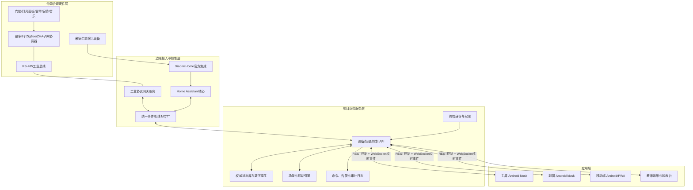

# 智慧家居步入式实训台：合同、硬件与软件深度调研报告

> 调研日期：2026-07-21（Asia/Shanghai）  
> 调研范围：当前目录内 6 个源文件，以及小米、Home Assistant、Android 官方一手资料。  
> 判定原则：合同文件《步入式实训台0610(1).docx》为需求上位依据；硬件表、技术方案和两份研究报告均属于建议、估算或辅助论证，不能覆盖合同原文。

## 一、执行结论

1. **合同不是明确要求开发“两套智慧大屏软件”**。它明确要求的是一套“智家大脑屏/智家显示屏”能力，具有主屏（≥12.3 英寸）和副屏（≥7 英寸），支持“上下双屏分别控制不同场景功能、实时同步”。最合理的软件交付是：**一个统一控制系统、一个代码库、两个安卓显示端配置**，而不是两套彼此独立的系统。
2. **整套合同实际不止两个显示面**：除主屏和副屏外，第 8 条还有 4 英寸灯光中控屏，第 16 条还有 7 英寸背景音乐主机屏。前两者构成需要定制同步的“智家大脑双屏”；后两者通常是专用设备自带界面，但必须接入统一控制与状态联动。
3. **可以运行在 Android 11 及以上的安卓显示终端上**，但不建议把普通消费级平板直接等同于合同设备。合同还要求摄像头、四麦降噪、2W×2 扬声器、ZigBee 3.0、双频 Wi-Fi/蓝牙 5.2、双以太网等能力；普通平板通常不同时具备 ZigBee 和 2 个 RJ45。推荐使用嵌入式安卓工控屏或集成式双屏设备。
4. **参考 PNG 是同一系统的两个业务页面**：上半为“场景”，下半为“设备”。它能作为主屏 UI 参考，但不能单独证明“上下双屏实时同步”已经实现；合同第 3 条还要求投标时提供功能截图并盖章。
5. **现有硬件表不能直接作为合同合规采购清单**。它是“米家生态可演示方案”，不是“17 条合同逐条满足方案”。至少存在：RS-485 多子网未实现、副屏分辨率不符、门锁容量不符、六路 485 灯光面板缺失、安防协议与射频指标不符、背景音乐证据不足、架体和部分音响成本为空等问题。
6. **完全契合合同的实现不能是纯米家消费级方案**。应采用“工业/合同合规硬件层 + 统一边缘控制层 + 米家/HA 适配层 + 双屏应用层”的混合架构。米家设备可作为生态演示设备，但凡无法满足合同硬参数的品类，应更换为有检测报告或厂商规格书的合规设备。
7. **Home Assistant 适合作为设备抽象、场景和自动化核心，但不是合同唯一指定平台**。若采用 Xiaomi Home 官方集成，必须区分“小米中枢网关”与普通“多模网关”；没有受支持的中枢网关时，控制命令仍可能走小米云。合同的“8 子网络 + RS-485”还需要独立的工业网关能力，不能靠 HA 或米家 App 自动获得。

## 二、项目文件逐份理解

### 2.1 《步入式实训台0610(1).docx》

这是唯一直接列出采购/验收参数的文件，共 17 条。其内容可归为：

- 1–3：多协议网关、主副显示屏、上下双屏同步；
- 4–5：门锁控制系统及门锁能力；
- 6–8：灯光控制、六路触控面板、4 英寸中控屏；
- 9–10：窗帘控制和电机参数；
- 11–14：人体、门窗磁、水浸三类安防设备及射频参数；
- 15–16：背景音乐及 7 英寸音乐主机；
- 17：语音控制场景与单设备。

合同没有直接规定软件技术栈、数据库、服务器型号、APK/PWA、Home Assistant 或米家云，也没有规定软件必须拆成几套。软件范围应从“用户必须能够完成的控制、联动、同步和状态反馈”反向推导。

### 2.2 《副本步入式实训硬件0610修改版2(1).xlsx》

工作簿只有“成本估算”一个工作表，50 行有效数据，按两套估价。表内公式无明显错误，显示：

- 单套总计约 **11,387 元**；
- 两套总计约 **22,774 元**。

但这两个数字不是完整交付价：实训台架体为空，背景音乐喇叭数量/单价为空，也未计入边缘服务器、交换机/UPS、软件开发、集成测试、施工、检测、培训、资料和维保。第 5 行名称写“13.3 寸”，嵌入的商品截图却选择“15.6 寸 1920×1080”，说明具体 SKU 尚未冻结。

硬件清单本质上是“尽量使用小米/米家生态”的估算，且备注已经主动披露多处合同缺口，不能把价格表中的“购买理由”当作技术合格证明。

### 2.3 《智慧家居装调实训系统_技术方案_V2.3.pdf》

PDF 实际为 17 页，提出三模块：

- 模块一：步入式装调台物理载体；
- 模块二：基于 Home Assistant 的本地方案；
- 模块三：基于米家 App/小米云的云端方案。

正文把模块二与模块三定义为默认“二选一”，第 5.4 节才把“双方案并行”列为进阶演进方向。文件名写 V2.3，封面写 V2.0，版本需统一。它还提出 A–E 五个区域、强弱电分槽、故障注入、边缘服务器、Node-RED/InfluxDB/Grafana 等，但这些不都出现在 17 条合同中；若纳入交付，必须区分“合同义务”和“增强教学功能”。

### 2.4 《米家HA实训台可行性深度分析报告.docx》

报告认为“米家 + Home Assistant”可行，给出最小验证路径、HA 安装、Xiaomi Home 集成、OAuth 和断网测试思路。它适合作为 PoC 指南，但部分结论不能直接用作采购验收依据：

- 把“双方案并行”作为最优解，与 PDF 默认二选一的正文口径不同；
- 将一些延迟、版本和兼容性结论写得过于确定，但没有限定具体设备、固件和测试环境；
- 未解决合同中的 RS-485 八子网、六路 485 面板、精确射频参数等硬指标。

### 2.5 《米家设备HA兼容清单+PDF技术Review.docx》

该文件有价值的部分是指出：版本混乱、固件门槛、BLE/摄像头边界、Docker 配置、OAuth 教学账号、故障注入软件联动等落地风险。需要修正或复核的部分是：

- 将 `xiaomi.gateway.hub1` 直接称为“小米多模网关2”风险很大；小米官方页面和官方支持型号表称其为“小米中枢网关”，必须按设备 model/固件实机核验；
- “某协议全部支持/不支持”不能替代具体 SKU 的 MIoT 物模型、固件和断网实测；
- 推荐设备表与当前 XLSX 清单并不一致，因此不能混合引用后声称采购已完成闭环。

### 2.6 `fa39ebc19edf2b955fa9ae786286e606.png`

图片分为上下两张 1619×约 486 的界面：

- 上图是“场景”页：回家、离家、观影、睡眠等场景，以及联动动作；
- 下图是“设备”页：房间分类、设备卡片、空调详情控制；
- 左侧导航还包含首页、安防、环境、能耗、设置。

它适合作为统一智慧家居控制系统的视觉和信息架构参考。图片日期为 2024-05-20，不能作为 2026 年项目已经完成的软件证据。

## 三、合同 17 条逐项拆解与现有硬件符合性

| 条款 | 合同核心要求 | 现有硬件表判断 | 完全契合所需动作 |
|---|---|---|---|
| 1 | ZigBee/Wi-Fi；APP；状态反馈；灯/帘/空调/场景；最多 8 子网；子网以 485 连接；ZigBee/ZHA | **不符合**。多模网关无 RS-485；一套只有少量网关，未证明 8 子网 | 采用具备 RS-485 背板的工业分布式 ZigBee 网关，明确 8 个协调器/子网寻址、跨网路由、回环抑制和测试工具 |
| 2 | 主≥12.3、1920×720；副≥7、1424×280；双触控；Android≥11；4 核 ARM；2G+16G；500 万摄像头；四麦；2W×2；ZigBee/Wi-Fi/BT5.2；双网口 | **部分符合**。主屏基础规格接近；副屏 1024×600 不符 1424×280；ZigBee、BT5.2、双网口、四麦等缺乏整机证据 | 冻结准确 SKU 和完整规格书；优先定制一体化双屏或两台工业屏；实机核验两个触控、摄像头、音频、网络、Android API |
| 3 | 上下双屏可分别控制不同功能，实时同步；投标截图盖章 | **未证明**。两台独立工控机只是硬件设想 | 建设统一状态源、双端会话、WebSocket 事件流、断线重连和冲突处理；形成主/副屏同时操作截图与录像证据 |
| 4 | 包含门锁控制系统 | **部分符合** | 软件提供锁状态、事件、用户凭证管理边界、联动和审计；主动开锁必须按设备安全策略与授权实现 |
| 5 | 人脸/指纹/密码/卡/钥匙/临时密码；密码≤8 位；指纹≥100；密码≥10；卡≥40 | **不符合**。表中门锁备注明确指纹 50、NFC 25 | 更换满足容量的型号并取得盖章规格书/检测报告；不能用软件虚拟容量补足实体门锁容量 |
| 6 | 灯光开关、明暗、冷暖、自由组合场景、回家/离家、单负载 | **可演示但未完全证明** | 选择实际支持亮度/色温写入的灯具；场景引擎保存动作快照并提供逐负载控制、执行结果和失败反馈 |
| 7 | 六路负载、485、2.4G、160×90×8±5、触摸、2.4G ZigBee 子网 | **不符合**。现有米家面板为 3.23 英寸/3 路，备注承认无 485 六路调光面板 | 采购合同型六路触控面板；为每路提供地址、开关/调光映射、485 寄存器表及 ZigBee 入网证明 |
| 8 | 4 英寸 Android 中控；Wi-Fi/蓝牙/ZigBee3.0；网关/开关/语音；七类生态 | **未充分符合**。3.23 英寸面板与 3.97 英寸 Mini 分属不同条目，未证明一个设备同时满足全部能力 | 选用一个可由厂商证明满足整条的 4 英寸中控屏，逐项演示灯控、调光、遮阳、温控、环境、音乐、语音 |
| 9 | 窗帘系统含 1 台电机 | **基本符合** | 固化电机、轨道、控制器和安装包数量 |
| 10 | 1.2N·m；≥14cm/s；≥50kg；50/60Hz；100–240V；电子限位、遇阻停、停电手拉；ZigBee | **参数接近，证据待补**。Aqara C3 表内声称 2.0N·m、4–16cm/s、80kg、ZigBee3.0 | 取得官方规格书，特别核验速度口径、遇阻停止、手拉和米家/控制平台的实际可控属性 |
| 11 | 人体、门磁、水浸三类 | **品类符合** | 数量和安装位置应进入点位表 |
| 12 | 人体 ZigBee3.0、19dBm、3V、三类告警、角≥100°、距≥6m | **不符合**。现选蓝牙 Mesh，未证明 19dBm/防拆 | 更换有完整 ZigBee3.0 与射频/防拆证明的型号 |
| 13 | 门磁 ZigBee3.0/2.4GHz、19dBm、300m、3V | **不符合**。现选蓝牙 Mesh，且未证明 19dBm/300m | 更换合同型 ZigBee 门磁；明确“300m”测试条件（空旷/视距）并保留报告 |
| 14 | 水浸 ZigBee3.0/2.4GHz、300m、-100dB、3V、19dBm | **不符合**。现选蓝牙 Mesh，未证明射频指标 | 更换合同型 ZigBee 水浸；取得 RF 报告或盖章参数 |
| 15 | 背景音乐可开关，含 1 台智能主机 | **部分符合** | 完成主机、功放、扬声器、APP/屏控、音源和音量控制闭环 |
| 16 | 7 英寸；按键 LED；震动反馈；双路 D 类功放；云音乐/电台/TF/AUX/手机推送；多格式 | **未充分证明**。R11 只在表内证明部分能力；喇叭数量/价格为空，备注又出现 Mini4X | 冻结唯一型号及套餐，逐项取得厂商资料并实机验收 TF/AUX/推送/格式/震动/LED |
| 17 | 语音控制场景和单设备，具备语音交互 | **可演示但依云**。家庭屏 Mini 可用于小爱语音 | 明确联网依赖、唤醒词、可控设备白名单、场景词库、失败反馈；若要求断网语音需另加本地 ASR/NLU |

### 硬件表中的其他重要问题

- 第 31 行吸顶喇叭数量和单价为空，公式按空值计 0；
- 第 35–36 行实训台架体未列任何设备或价格；
- 合同提到空调控制，但硬件表没有空调或红外控制器；若合同第 1 条按功能验收，需要增加可控空调/模拟负载或明确由既有设备提供；
- PDF 的 A 区要求边缘服务器、交换机、UPS 和配电箱，硬件表未完整列出；这些虽不都属于 17 条合同硬参数，但采用本地 HA 时是运行必需；
- RS-485 线缆被采购，不代表 RS-485 功能成立；链路两端必须有真实 485 接口、协议和设备地址；
- “USB ZigBee 模块支持 Android”不能只看 USB 能插入，必须核验内核串口驱动、设备节点权限、协调器固件、协议栈和应用 API。

## 四、合同涉及的软件开发到底是什么

### 4.1 合同明确要求的软件能力

合同虽没有“软件功能清单”章节，但要让 17 条可验收，至少必须开发或配置以下能力：

1. **设备接入与状态模型**：网关、灯、窗帘、门锁、人体、门磁、水浸、音乐、语音等统一设备模型；在线/离线、属性、事件、动作和故障状态。
2. **设备控制**：灯光开关/亮度/色温、窗帘开合/暂停、音乐开关/音量/音源、允许范围内的门锁操作。
3. **场景管理与执行**：回家、离家等场景；场景动作编排、一键执行、逐动作结果和失败重试。
4. **自动联动**：传感器或门锁事件触发灯光、窗帘、音乐等动作。
5. **双屏应用**：主副屏可显示不同功能，任一端操作后另一端实时刷新；包括设备状态、场景状态、网络和告警。
6. **移动端入口**：合同第 1 条的“移动端 APP”。可由定制安卓应用、受控 Web/PWA，或经书面确认的米家 App 承担；如果项目要体现自主软件开发，应交付定制 Android 客户端。
7. **语音入口**：场景和单设备控制、确认/错误反馈。
8. **运维和验收工具**：设备配网、地址绑定、在线诊断、日志、版本、截图模式和故障定位。

### 4.2 “是不是两个智慧大屏”的准确回答

**硬件上是两个显示面：主屏 + 副屏；软件上应是一套智慧家居控制系统的两个视图/终端。**

这里的“两个”只指第 2–3 条的智家大脑主副双屏，不包含第 8 条 4 英寸灯光中控屏和第 16 条 7 英寸背景音乐主机；后两者是额外的专用显示终端。

推荐定义：

- 主屏：总览、场景、房间、设备详情、安防、环境、能耗、运维；
- 副屏：常用场景快捷键、告警条、当前房间/当前设备、音乐或快捷控制；
- 两屏都可发控制命令，但根据屏幕角色限制功能；
- 两屏不互相直接复制状态，而是订阅同一服务端权威状态；
- “实时同步”是设备状态、场景执行状态和告警同步，不是要求两个屏幕显示完全相同的画面。

### 4.3 是不是用安卓平板打开

**可以在 Android 11+ 终端上打开，但交付形态建议是“安卓工控屏 + kiosk APK”，不是让用户手动打开浏览器。**

推荐采用混合壳：

- 前端主体用响应式 Web 技术开发，主副屏共用组件与业务代码；
- 通过 Android APK 壳提供开机自启、沉浸全屏、屏保/亮度、网络检测、USB/串口权限、远程更新和离线缓存；
- APK 启动时读取 `screenRole=primary|secondary`，加载相应路由和布局；
- 如果上下屏属于同一 Android 主机，需在定制硬件上验证 Android 的 secondary-display 能力和双触控映射；Android 提供 `ActivityOptions.setLaunchDisplayId`、`DisplayManager`/`Presentation` 等接口，但设备 OEM 必须支持 secondary-display activity，不能仅凭 Android 版本推定；
- 如果是两台独立安卓工控机，则通过局域网 WebSocket 同步，工程风险更低，但必须解决设备身份、断线重连、双端冲突、时钟和版本一致性。

## 五、推荐的完整技术架构

### 5.1 为什么不能让双屏直接调用每个设备

如果屏端分别直连米家、485、ZigBee 或 HA，会产生四个问题：状态不一致、权限分散、失败难审计、设备更换导致 UI 重写。统一业务服务应维护每个设备的规范化状态，并给每次命令分配 `commandId`：

1. 屏端发出命令；
2. 服务端校验设备/权限/参数并记录 `PENDING`；
3. 适配器向 HA、米家或工业网关下发；
4. 收到设备回报后更新权威状态；
5. 通过 WebSocket 向主屏、副屏和移动端广播；
6. 超时则显示失败/未知，不允许前端固定显示“成功”。

### 5.2 软件模块和建议路由

| 模块 | 主屏 | 副屏 | 移动端 | 关键服务 |
|---|---|---|---|---|
| 首页总览 | `/home` | `/quick` | `/home` | 在线率、告警、场景、网络 |
| 场景 | `/scenes` | `/quick/scenes` | `/scenes` | CRUD、动作排序、执行、回滚/失败 |
| 设备 | `/devices` | `/quick/device/:id` | `/devices` | 房间、类别、状态、控制能力 |
| 安防 | `/security` | `/alerts` | `/security` | 门锁事件、人体/门磁/水浸、确认 |
| 环境 | `/environment` | `/quick/environment` | `/environment` | 传感器和趋势（有设备时） |
| 音乐 | `/music` | `/quick/music` | `/music` | 开关、音量、音源、播放状态 |
| 运维 | `/ops` | 只读网络状态 | 管理员可见 | 网关、子网、485、配网、日志 |
| 设置 | `/settings` | 屏幕设置 | 账户/终端 | 屏角色、主题、版本、时间 |

### 5.3 核心数据对象

- `Device`：设备、厂商型号、房间、子网、协议、适配器、在线状态；
- `Capability`：开关、亮度、色温、开合度、音量、告警、只读状态等；
- `DeviceState`：当前值、质量、来源、设备时间、服务端时间和版本号；
- `Command`：发起端、目标、参数、状态、超时、错误、确认时间；
- `Scene` / `SceneAction`：触发条件、动作序列、延迟、失败策略；
- `Automation`：传感器事件到场景/设备动作；
- `Gateway` / `Subnet`：网关、485 地址、ZigBee PAN/channel、健康状态；
- `AlarmEvent`：安防事件、严重度、确认人、恢复时间；
- `ScreenClient`：主/副/移动端身份、在线、版本、最后心跳；
- `AuditLog`：控制、配置、配网、登录和异常记录。

## 六、网关与 8 子网的正确实现方式

合同第 1 条是整套方案中最难、也最容易被“买了一卷 485 线”假完成的部分。建议实现为应用层桥接，而不是尝试把 8 个 ZigBee PAN 直接电气并网：

1. 每个子网有独立 ZigBee 协调器、PAN ID、信道和设备地址空间；
2. 每个子网控制器有唯一 RS-485 地址；
3. 中央网关轮询或接收子网事件，将其转换为统一设备事件；
4. 跨子网控制由中央网关执行“源事件 → 规则 → 目标子网命令”；
5. 帧中必须有源子网、目标子网、序号、时间戳/TTL、CRC 和 ACK，避免重复执行与消息环路；
6. 建立 8 子网测试夹具，至少验证寻址、同时在线、跨网控制、总线断开、节点冲突、恢复和延迟；
7. ZHA 在合同语境中应确认是 ZigBee Home Automation profile，还是投标文件中的专有称呼；未澄清前保留原词，不自行改名。

纯小米多模网关没有 RS-485 物理接口，不能完成这条。可行选择只有：采购原合同厂商的合规网关、采购工业多子网网关，或定制子网控制器和中央网关。

## 七、Home Assistant 与米家接入的现实边界

截至本报告日期，小米官方 `XiaoMi/ha_xiaomi_home` 文档确认：

- 需要 Xiaomi Home OAuth 登录导入设备；token、证书等会保存在 HA 配置中，应保护配置备份；
- 支持大部分米家品类，但蓝牙、红外、虚拟设备等仍有不支持范围；
- 本地模式依赖“小米中枢网关”（固件 ≥3.3.0_0023）或官方列表中的内置中枢设备（软件 ≥0.8.9）；没有这些设备时控制指令走小米云；
- 普通“小米局域网控制”只覆盖同网段 IP 设备，不能借此控制 BLE Mesh 或 ZigBee 子设备；
- 官方支持型号表列出 `xiaomi.gateway.hub1` 等中枢型号，并指出部分老设备即使连接中枢网关也不能很好地向本地 broker 上报属性。

因此必须建立“逐 SKU 兼容性验收表”，对每台设备记录：商品名、铭牌 model、固件、MIoT URN、HA 实体、可读属性、可写动作、控制路径（local/cloud）、断网测试结果。不能只按协议名推断。

## 八、实施路径

### 阶段 0：合同冻结与澄清（1–2 周）

- 将 17 条转成带原文的合同台账；
- 书面澄清副屏分辨率 `1424×280` 是精确值还是最低值；
- 澄清“两个独立安卓屏”是否可等价于“上下双屏智家大脑屏”；
- 澄清 ZHA、8 子网的现场验收方式；
- 澄清是否必须全部采用米家品牌，以及主动远程开锁是否要求；
- 统一 PDF V2.0/V2.3 版本。

### 阶段 1：先做高风险 PoC（2–4 周）

PoC 不是只测一盏灯，应一次消除五类最大风险：

1. 主副屏不同分辨率同时运行并实时同步；
2. 真实 485 子网节点跨网控制；
3. 小米中枢网关的准确 model/固件、HA local/cloud 路径；
4. 门锁、六路面板、三类安防设备的合同参数证明；
5. 安卓 USB ZigBee/串口驱动及开机自启。

PoC 出口标准：每项有录像、日志、设备铭牌、固件截图、抓包或状态时间线。

### 阶段 2：硬件设计与样机（4–8 周）

- 完成结构图、点位图、强弱电图、485 拓扑、端子表和设备 BOM；
- 冻结全部 SKU，不接受“触想/佳维视/其他”这类未定品牌写法；
- 制作一套样机，完成安规、接地、漏保、散热、线缆标签和可维护性检查；
- 为每条合同参数绑定证据文件。

### 阶段 3：软件平台与双屏（6–10 周，可与阶段 2 并行）

- 建设统一设备模型、适配器、状态库、命令和场景服务；
- 开发主屏/副屏/移动端共享前端和 Android kiosk 壳；
- 实现 WebSocket 同步、断线重连、离线提示、命令确认和审计；
- 接入 HA、工业网关、背景音乐和语音；
- 建设教师运维页和验收数据集。

### 阶段 4：集成、课程与验收（3–6 周）

- 完成 17 条逐项黑盒测试；
- 完成 8 子网压力/故障测试和断网测试；
- 输出投标截图、操作录像、测试报告、规格书、培训手册、实训指导书；
- 冻结 APK、服务端镜像、配置、账号、设备固件和回滚包。

## 九、必须具备的验收用例

1. 主屏开灯，副屏和移动端在限定时间内同步状态；副屏调光，主屏同步；
2. 执行“回家”场景，逐项展示灯、帘、音乐等动作成功/失败；
3. 断开公网但保留局域网，分别记录每个设备是否仍可控制，禁止用一个灯的结果代表全部设备；
4. 断开主屏网络，副屏仍能控制；恢复后主屏自动全量校准；
5. 同时在两屏发相反命令，系统按服务端版本顺序收敛并保留审计；
6. 8 个子网全部寻址；从子网 1 的传感器触发子网 8 的灯；断开 485 后出现明确告警；
7. 门锁现场录入至少 100 枚指纹、10 组密码、40 张卡，或由合同认可的检测报告替代破坏性测试；
8. 六路面板六路负载独立控制，485 和 ZigBee 两种链路按约定验证；
9. 人体、门磁、水浸分别触发，主副屏显示告警、时间、设备和确认状态；
10. 背景音乐依次测试网络电台、TF、AUX、手机推送和规定音频格式；
11. 语音控制一个场景和一个单设备，测试歧义、离线和失败反馈；
12. Android 设备断电重启后自动进入全屏应用，版本和屏幕角色正确，无需人工点浏览器。

## 十、交付物清单

- 合同符合性台账（17 条原文、解释、硬件、软件、测试、证据、状态）；
- 冻结 BOM、厂商盖章规格书、检测报告、序列号/固件清单；
- 结构、安装、强弱电、485、网络、点位、端子图；
- 后端服务、数据库迁移、适配器、主副屏/移动端源码；
- Android APK、签名与 kiosk/开机自启配置；
- 容器/服务部署文件、备份恢复、账号与密钥管理 SOP；
- 设备配网、场景、语音、故障注入和课程实训手册；
- 自动测试、黑盒脚本、截图/录像、日志和验收报告；
- 软件版本、硬件固件、配置快照和回滚包。

## 十一、最终建议

立项时把方案正式命名为：**“合同合规型智慧家居实训台 + 米家生态适配 + Android 双屏控制系统”**。

不要把项目命名或范围收缩成“米家双屏页面开发”，因为真正决定能否验收的是多子网 RS-485、精确设备参数、状态闭环和双屏同步。推荐先冻结合同台账并完成一套高风险 PoC，再批量采购两套；当前 XLSX 只能作为询价底稿，不能作为最终 BOM。

## 十二、外部一手资料

- [小米官方 Home Assistant 集成（中文 README）](https://github.com/XiaoMi/ha_xiaomi_home/blob/main/doc/README_zh.md)
- [小米官方中枢网关支持型号表](https://github.com/XiaoMi/ha_xiaomi_home/wiki/Central-hub-gateway-device-models)
- [小米商城：小米中枢网关](https://www.mi.com/shop/buy/detail?product_id=15755&cfrom=search)
- [Home Assistant REST API](https://developers.home-assistant.io/docs/api/rest/)
- [Home Assistant WebSocket API](https://developers.home-assistant.io/docs/api/websocket/)
- [Android ActivityOptions.setLaunchDisplayId](https://developer.android.com/reference/android/app/ActivityOptions#setLaunchDisplayId(int))
- [Android DisplayManager](https://developer.android.com/reference/android/hardware/display/DisplayManager)
- [Android Presentation](https://developer.android.com/reference/android/app/Presentation)·
